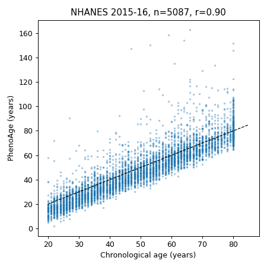
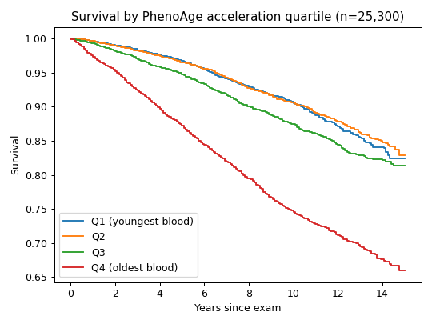
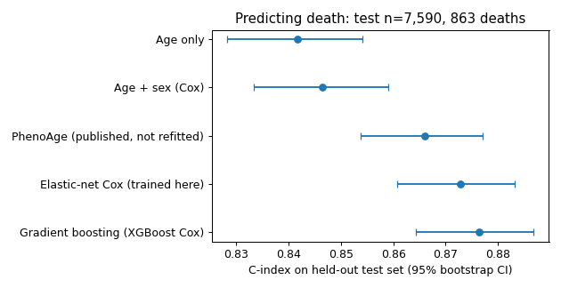
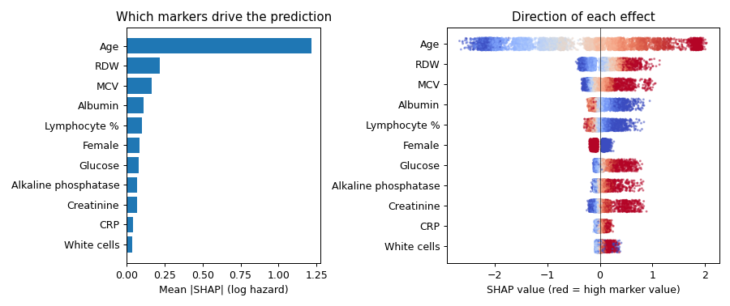

# Blutalter: biological age from routine blood tests

How old is your blood? This project computes **PhenoAge**, a biological-age score built from nine routine blood markers plus age, for adults in the US National Health and Nutrition Examination Survey (NHANES), and tests whether being "older than your age" predicts mortality.

Status: **v1.0, complete** (all four steps done).

## Key results

- **25,300 adults**, five NHANES cycles (2005–2010, 2015–2018), **2,874 deaths** over up to 14 years.
- PhenoAge implemented from the paper and matched to the BioAge R package to within **0.0008 years**.
- Each 1 SD (8.4 years) of PhenoAge acceleration: hazard ratio **1.54 (95% CI 1.50–1.57)** for all-cause death, adjusted for age and sex; stable across cycles, sexes, age groups and sensitivity analyses.
- On a held-out test set (7,590 people, 863 deaths), models trained here on the same markers beat the published score: **C-index 0.876 (XGBoost Cox) and 0.873 (elastic-net Cox) vs 0.866 (PhenoAge) vs 0.842 (age alone)**. The gain over PhenoAge is small but its bootstrap 95% CI excludes zero.
- SHAP: after age, **red cell distribution width (RDW), MCV, albumin and lymphocyte %** carry the most information.

## Plan

| Step | What | Status |
| --- | --- | --- |
| 1 | Data pipeline: NHANES 2015–2016 + linked mortality into DuckDB, one analysis table | done |
| 2 | PhenoAge implementation, checked against the R package BioAge | done |
| 3 | Pool NHANES cycles; Cox model of age acceleration vs. all-cause mortality | done |
| 4 | Machine learning (elastic net, gradient boosting) vs. PhenoAge, compared by C-index; SHAP | done |

## Data

Public NHANES 2015–2016 files from CDC: demographics (`DEMO_I`), complete blood count (`CBC_I`), biochemistry (`BIOPRO_I`), hs-CRP (`HSCRP_I`), and the NCHS public-use linked mortality file. No data are stored in this repository; `load_nhanes.py` downloads them.

## Reproduce

```bash
conda env create -f environment.yml
conda activate blutalter
python load_nhanes.py      # download + load into data/nhanes.duckdb
python build_analysis.py   # writes data/analysis.csv
python phenoage.py         # writes data/phenoage.csv, figures/, results/
Rscript r/check_bioage.R   # cross-check against the BioAge R package
python pool_cycles.py      # five cycles -> data/pooled.csv
python cox.py              # Cox models -> results/week3_cox.csv, figures/km_accel_quartiles.png
python ml.py               # ML vs PhenoAge -> results/week4_*.csv, figures/week4_*.png
```

Without conda: `python -m venv .venv && .venv/bin/pip install duckdb pandas numpy matplotlib certifi lifelines scikit-learn xgboost`. On a python.org build of Python on macOS, `certifi` is needed for the CDC downloads.

## Data flow: who is dropped and why

| Step | Rule | People left |
| --- | --- | --- |
| All participants | `demo` | 9,971 |
| Adults with exam | age >= 20, `ridstatr = 2` | 5,474 (of 5,719 adults) |
| Eligible for mortality follow-up | `eligstat = 1`, follow-up months present | 5,459 |
| Complete markers | all 9 markers present, hs-CRP > 0 | 5,087 (222 deaths, 4.4%) |

*Numbers are from the actual run.*

## Results so far (NHANES 2015–2016, n = 5,087, 222 deaths)



| Check | Result |
| --- | --- |
| Correlation of PhenoAge with age | 0.90 |
| Agreement with BioAge R package (original Levine coefficients) | max difference 0.0008 years on 5,077 people |
| C-index for mortality, age alone | 0.837 |
| C-index for mortality, PhenoAge | 0.866 |
| Hazard ratio per 1 SD of age acceleration, adjusted for age and sex | 1.50 (95% CI 1.41–1.59) |

Notes:
- The BioAge formula returns infinity for 10 people whose predicted mortality rounds to 1 (PhenoAge 129–163 years). The Python version computes the cumulative hazard directly, so these rows stay finite. They are extreme values and are kept for now; step 3 will check whether they change the Cox results.
- The C-index is in-sample here. Gains from PhenoAge over age are small and will be compared properly with cross-validation in step 4.

## Week 3: five pooled cycles (n = 25,300, 2,874 deaths)

Cycles 2005–2006, 2007–2008, 2009–2010, 2015–2016 and 2017–2018 (2011–2014 measured no CRP). Mortality follow-up runs to 31 Dec 2019, so the older cycles carry most of the deaths.

| Cycle | Participants | Adults with exam | Mortality-eligible | Complete markers | Deaths |
| --- | --- | --- | --- | --- | --- |
| 2005–2006 | 10,348 | 4,773 | 4,771 | 4,427 | 874 |
| 2007–2008 | 10,149 | 5,707 | 5,701 | 5,276 | 935 |
| 2009–2010 | 10,537 | 6,059 | 6,045 | 5,645 | 731 |
| 2015–2016 | 9,971 | 5,474 | 5,459 | 5,087 | 222 |
| 2017–2018 | 9,254 | 5,265 | 5,231 | 4,865 | 112 |
| **Total** | **50,259** | **27,278** | **27,207** | **25,300** | **2,874** |

**Main result.** Cox model with age and sex, stratified by cycle: each 1 SD (8.4 years) of PhenoAge acceleration carries a hazard ratio of **1.54 (95% CI 1.50–1.57)** for all-cause death, i.e. **1.29 per 5 years** of acceleration. The proportional-hazards test for acceleration gives p = 0.55 (no evidence of violation).

| Model | n | Deaths | HR per SD (95% CI) |
| --- | --- | --- | --- |
| Main: age + sex, stratified by cycle | 25,300 | 2,874 | 1.54 (1.50–1.57) |
| Survey weights (robust SE; no strata/PSU) | 25,300 | 2,874 | 1.59 (1.53–1.66) |
| Not winsorised (raw acceleration, SD 9.3 y) | 25,300 | 2,874 | 1.28 (1.26–1.29) |
| Drop raw acceleration > 5 SD | 25,204 | 2,835 | 1.61 (1.56–1.66) |
| Drop deaths in first 2 years | 24,790 | 2,364 | 1.50 (1.46–1.55) |
| Age < 60 | 16,613 | 508 | 1.66 (1.57–1.75) |
| Age ≥ 60 | 8,687 | 2,366 | 1.52 (1.48–1.57) |
| Men | 12,255 | 1,669 | 1.50 (1.45–1.55) |
| Women | 13,045 | 1,205 | 1.61 (1.55–1.68) |
| Each cycle separately | 4,427–5,645 | 112–935 | 1.50 to 1.62 |

Full table: `results/week3_cox.csv`.



The curves are unadjusted; use the hazard ratios above for the size of the effect.

Decisions worth knowing:
- **Winsorising.** Acceleration has a long right tail: 96 people lie more than 5 SD above the mean, mostly with dialysis-level creatinine or extreme white-cell counts. Untreated, these points flatten the per-SD estimate (1.28) and made the age < 60 model fail to converge. Main models therefore clip acceleration at the 0.5th and 99.5th percentiles (−14.9 to +41.8 years; 254 people affected). Both versions are reported.
- **Age** is capped at 80 in all cycles, because 2005–2006 top-codes at 85 and later cycles at 80.
- **Dropping early deaths** barely changes the estimate, so the result is not driven only by people who were already very ill at the exam.
- C-index in the pooled data (in-sample): age 0.843, PhenoAge 0.865.

## Week 4: can a model trained here beat PhenoAge?

Same inputs for every model: the nine PhenoAge markers, age and sex. The pooled data were split once into training (70%, 17,710 people, 2,011 deaths) and test (30%, 7,590 people, 863 deaths), stratified by cycle and death. All tuning used 5-fold cross-validation inside the training set; the test set was used once, at the end. Each person appears in only one set.

| Model | Test C-index (95% CI) | Difference vs PhenoAge (95% CI) |
| --- | --- | --- |
| Age only | 0.842 (0.828–0.854) | −0.024 (−0.031 to −0.018) |
| Age + sex (Cox) | 0.846 (0.833–0.859) | −0.020 (−0.027 to −0.013) |
| PhenoAge (published, not refitted) | 0.866 (0.854–0.877) | reference |
| Elastic-net Cox (trained here) | 0.873 (0.861–0.883) | +0.007 (+0.003 to +0.010) |
| Gradient boosting, XGBoost Cox (trained here) | **0.876 (0.864–0.887)** | +0.011 (+0.007 to +0.014) |

CIs are from 500 bootstrap resamples of the test set; the difference CIs are paired. Tuned settings: elastic-net penalty 0.001 (l1 ratio 0.5); XGBoost depth 4, 168 trees (`results/week4_meta.json`).





What the models learned (SHAP for XGBoost; per-SD hazard ratios from the elastic net in `results/week4_enet_coefs.csv`):
- **Age** dominates, as it should for all-cause death.
- **RDW** (HR 1.32 per SD) and **MCV** (1.24) are the strongest blood markers; higher values mean higher risk. Both are cheap parts of a routine blood count.
- **Albumin** (0.80) and **lymphocyte %** (0.85) are protective.
- **CRP** contributes less here than in the original PhenoAge. One likely reason is that the cycles used two different CRP assays (see limitations).

How to read this: the published PhenoAge, trained on an older survey (NHANES III), is close to what can be learned from the same nine markers in newer data. Retraining gains about 0.01 in C-index. That is real but small, and the main value of PhenoAge remains that it is a fixed, transparent formula.

## Repository layout

- `load_nhanes.py`: download and load raw files
- `sql/`: queries, numbered in run order
- `build_analysis.py`: builds the analysis table with unit checks
- `phenoage.py`: PhenoAge, age acceleration, C-index and Cox model
- `r/check_bioage.R`: cross-check against the BioAge R package
- `nhanes_io.py`: download and parsing helpers shared by the pooling script
- `pool_cycles.py`: pools five cycles, harmonises units (CRP mg/L vs mg/dL), computes PhenoAge
- `cox.py`: Cox models, sensitivity analyses, survival figure
- `ml.py`: train/test split, elastic-net Cox, XGBoost Cox, bootstrap C-index, SHAP

## Limitations

- Survey weights are used only in one sensitivity model, and without the NHANES strata and primary sampling units, so its confidence interval is too narrow for population inference. Results describe the sample.
- Serum creatinine is not recalibrated across cycles; NHANES documentation recommends adjustments for some cycles. This could shift PhenoAge slightly between cycles; the per-cycle hazard ratios are similar (1.50–1.62).
- CRP in 2005–2010 is standard CRP, in 2015–2018 high-sensitivity CRP; both are converted to mg/dL but the assays differ at low concentrations.
- PhenoAge was trained on NHANES III, not these cycles, so steps 2–3 are an external check of a published score.
- The test set comes from the same cycles as the training set. A stricter test would train on 2005–2010 and test on 2015–2018, but the later cycles have too few deaths (334) for a precise estimate.
- C-index measures ranking only; calibration (whether predicted risks match observed risks) is not assessed.
- All-cause mortality only; cause-specific analyses are possible with the `ucod_leading` field.

## Reference

Levine ME et al. (2018). An epigenetic biomarker of aging for lifespan and healthspan. *Aging*, 10(4), 573–591.
